<div align="center">

# LLM Fundamentals · LLM Temelleri

**Bir cümle, bir dil modelinin içinde nasıl yolculuk eder?**

Tokenizer'dan attention'a, oradan eğitime kadar büyük dil modellerinin (LLM) temelleri:<br/>
Türkçe ders notları, **17 dakikalık animasyon** ve **çalıştırılabilir notebook'lar**.

[](https://www.remotion.dev/)
[](https://react.dev/)
[](https://www.typescriptlang.org/)
[](https://pytorch.org/)
[](LLM-Notebooks)


[▶️ Videoyu izle / indir](assets/LLM-Temelleri.mp4) ·
[📄 Notlar (PDF)](LLM%20Fundamental.pdf) ·
[🎬 Animasyon kodu](LLM-Animation) ·
[📓 Notebook'lar](LLM-Notebooks)

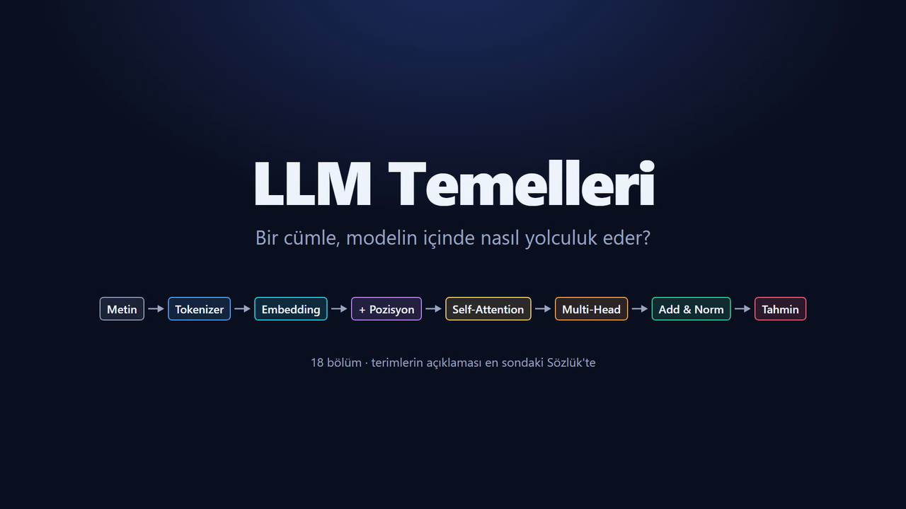

</div>

---

## Bu depoda ne var?

| | Ne | Nerede |
|---|---|---|
| 📄 | **Ders notları**: Tokenizer, Embedding, Attention, Transformer ve Eğitim (34 sayfa) | [`LLM Fundamental.pdf`](LLM%20Fundamental.pdf) · [`.docx`](LLM%20Fundamental.docx) |
| 🎬 | **Animasyon**: notların 18 bölümlük, 17:26 dakikalık görsel anlatımı (Remotion + React) | [`assets/LLM-Temelleri.mp4`](assets/LLM-Temelleri.mp4) · [`LLM-Animation/`](LLM-Animation) |
| 📓 | **Notebook'lar**: her bölümün PyTorch ile sıfırdan kodu, sıfırdan küçük bir GPT | [`LLM-Notebooks/`](LLM-Notebooks) |

Animasyonun en önemli özelliği: **hiçbir terim açıklamasız kalmaz.** Her ekranın sağ üstündeki sarı kutular,
o an geçen terimleri (softmax, GELU, Q/K/V, head, Wo, FFN, logit, loss, gradyan, RoPE …) tek cümleyle açıklar.
Videoda 74 terim kutusu var; en sondaki **Sözlük** bölümü de 44 temel terimi toplu hâlde verir.

---

## Animasyondan kesitler

<table>
  <tr>
    <td width="50%" align="center">
      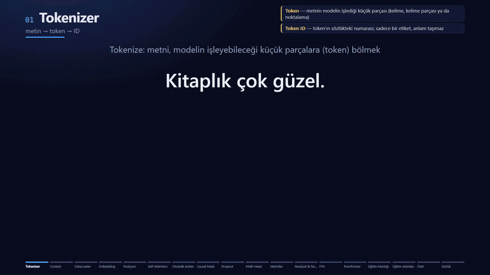<br/>
      <sub><b>Tokenizer</b>: metin → token → ID</sub>
    </td>
    <td width="50%" align="center">
      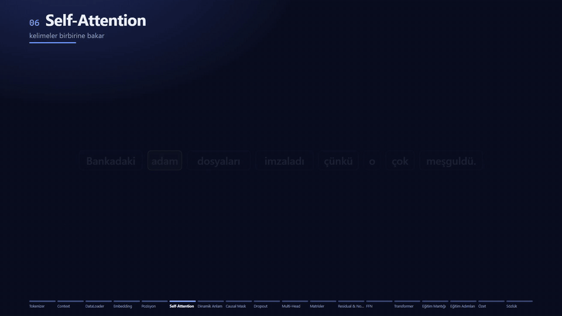<br/>
      <sub><b>Self-Attention</b>: "o" kime bakıyor? (%85 "adam")</sub>
    </td>
  </tr>
  <tr>
    <td width="50%" align="center">
      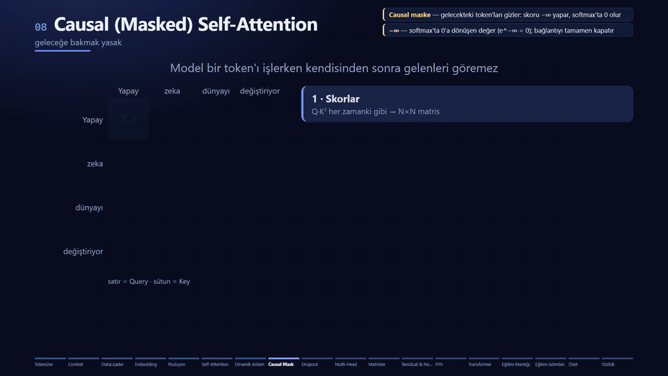<br/>
      <sub><b>Causal Mask</b>: gelecek −∞ ile gizlenir, softmax'ta 0 olur</sub>
    </td>
    <td width="50%" align="center">
      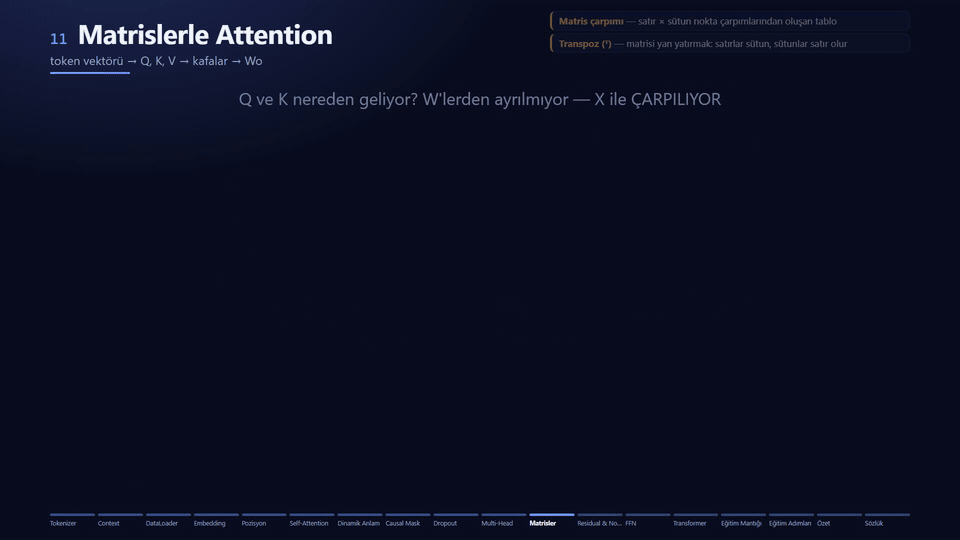<br/>
      <sub><b>Q ve K nereden gelir?</b> X × Wq = Q, sonra sütunlar kafalara</sub>
    </td>
  </tr>
  <tr>
    <td colspan="2" align="center">
      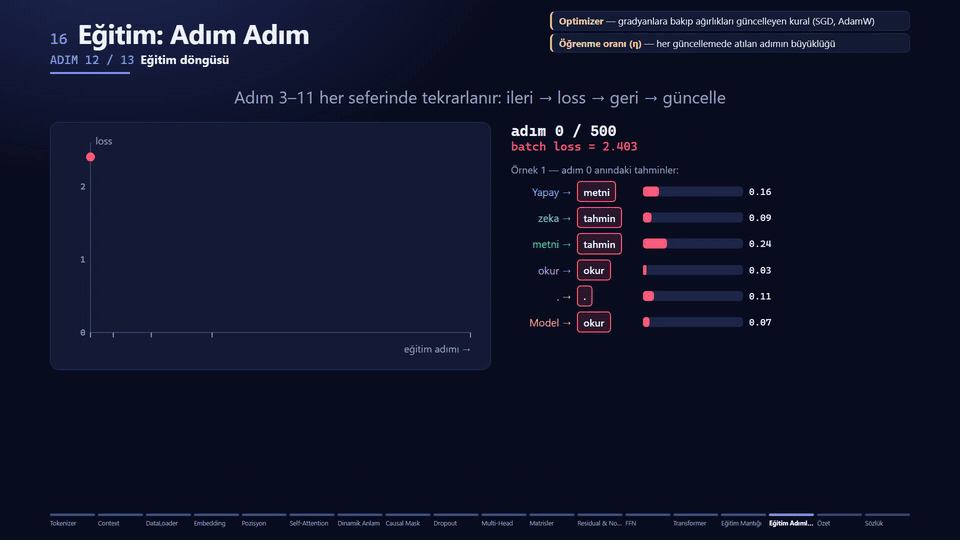<br/>
      <sub><b>Eğitim döngüsü</b>: 500 adımda loss 2.40 → 0.02, tahminler tek tek doğruya döner</sub>
    </td>
  </tr>
</table>

---

## Yolculuğun haritası

Videonun ve notların izlediği yol, bir decoder-only (GPT tipi) model üzerinden:

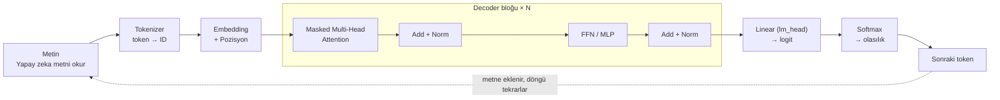

---

## Bölümler

Zamanlar videodaki başlangıç anıdır.

| Zaman | Bölüm | Neler anlatılıyor |
|------:|-------|-------------------|
| 0:07 | **01 · Tokenizer** | Metni token'lara bölmek, token ID, kelime / harf / alt kelime (BPE), detokenize |
| 0:37 | **02 · Context Length** | Bağlam penceresi; `-pt` ve `-it` modeller, SFT / RLHF |
| 1:06 | **03 · DataLoader** | Kaydırmalı pencere, girdi → hedef çiftleri, batch, stride, kırpılan token'lar ne olur |
| 2:11 | **04 · Embedding** | Token → vektör, d_model, "anlam haritası", embedding'in eğitimle öğrenilmesi |
| 2:45 | **05 · Positional Encoding** | Learned tablo, sinüsoidal, RoPE |
| 3:13 | **06 · Self-Attention** | Token vektörü, Q / K / V, Q·Kᵀ tablosu, √dₖ, softmax, × V |
| 4:04 | **07 · Dinamik Anlam** | Aynı kelimenin bağlama göre değişen anlamı, next-token tahmini |
| 4:39 | **08 · Causal Mask** | Geleceği −∞ ile gizlemek, satır satır kim kime bakabilir |
| 5:08 | **09 · Dropout** | Rastgele sıfırlama, 1/(1−p) ölçekleme, neden dropout'tan sonra softmax yok |
| 5:44 | **10 · Multi-Head Attention** | 96 kafa, 768 / 96 = 8, bölünen X değil W'lerin sütunları, concat, Wo |
| 6:28 | **11 · Matrislerle Attention** | Gerçek sayılarla: X → Q, K, V → kafa kafa puan tablosu → A·V → concat → Wo |
| 8:37 | **12 · Residual & LayerNorm** | Kestirme yol (skip connection), vanishing gradient, normalizasyon |
| 9:04 | **13 · FFN / MLP** | Genişlet → GELU → daralt; `gate_proj` / `up_proj` / `down_proj` (GeGLU) |
| 10:16 | **14 · Transformer Mimarisi** | Encoder, decoder, cross-attention, decoder-only (GPT) |
| 11:00 | **15 · Eğitimin Mantığı** | Tahmin → loss (cross-entropy) → gradyan → küçük adım → tekrar |
| 12:24 | **16 · Eğitim: Adım Adım** | Bir paragrafın eğitimi 13 adımda, her token ve her sayı görünür |
| 15:12 | **17 · Özet** | Bütün yolun tek ekranda tekrarı |
| 15:36 | **18 · Sözlük** | 44 terim, örnekleriyle |

Bölüm 11 ve 16'nın iç adımlarının zamanları [`LLM-Animation/README.md`](LLM-Animation/README.md) dosyasında.

---

## Ekran görüntüleri

<table>
  <tr>
    <td width="50%">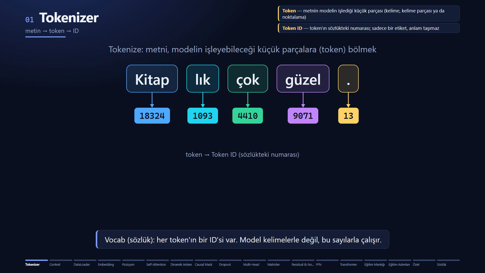</td>
    <td width="50%">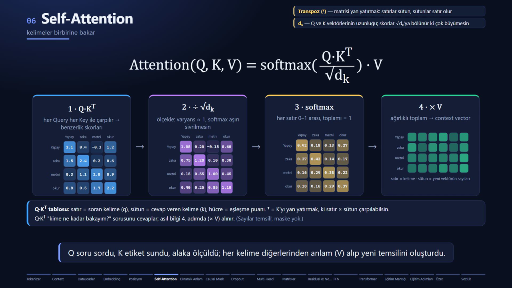</td>
  </tr>
  <tr>
    <td align="center"><sub>Tokenizer: her token'ın sözlükte bir ID'si var</sub></td>
    <td align="center"><sub>Attention(Q, K, V) = softmax(Q·Kᵀ / √dₖ) · V, dört adımda</sub></td>
  </tr>
  <tr>
    <td>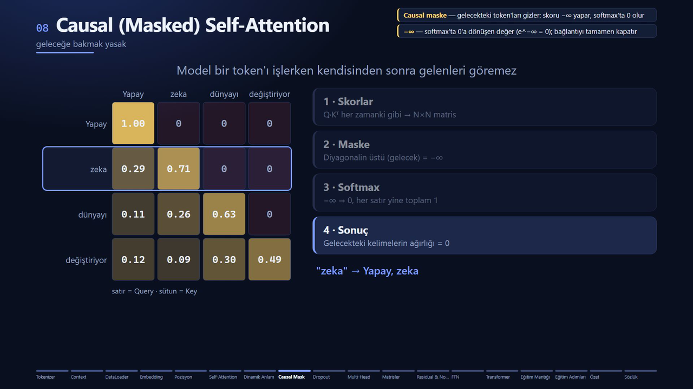</td>
    <td>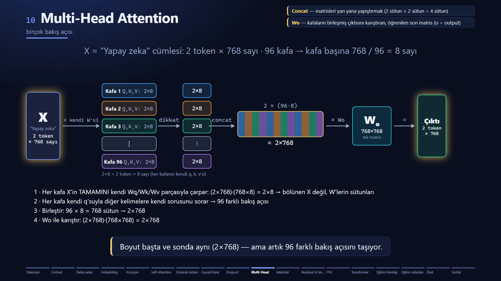</td>
  </tr>
  <tr>
    <td align="center"><sub>Causal mask: her satır sadece kendisine ve öncekilere bakar</sub></td>
    <td align="center"><sub>Multi-head: "Yapay zeka" (2 × 768) → 96 kafa × 8 → concat → Wo</sub></td>
  </tr>
  <tr>
    <td>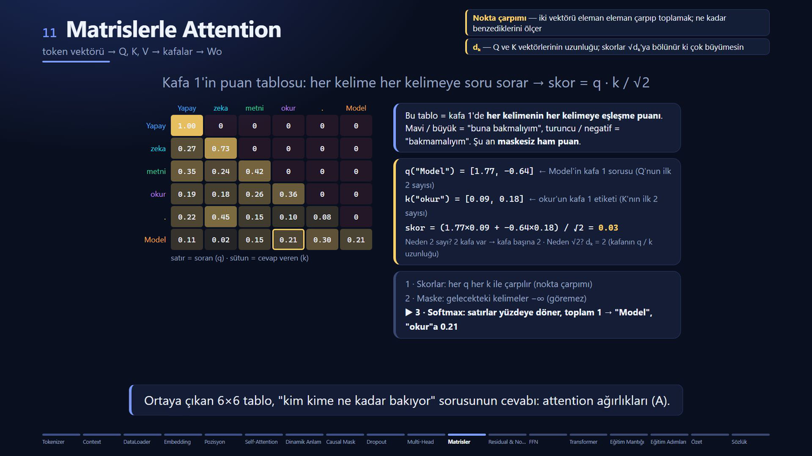</td>
    <td>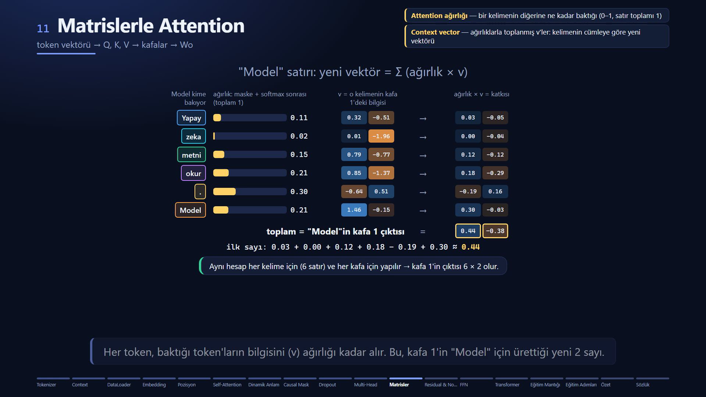</td>
  </tr>
  <tr>
    <td align="center"><sub>Kafa 1'in puan tablosu: bir hücrenin hesabı açık açık</sub></td>
    <td align="center"><sub>"Model" satırı: ağırlık × v toplamı → yeni vektör</sub></td>
  </tr>
  <tr>
    <td>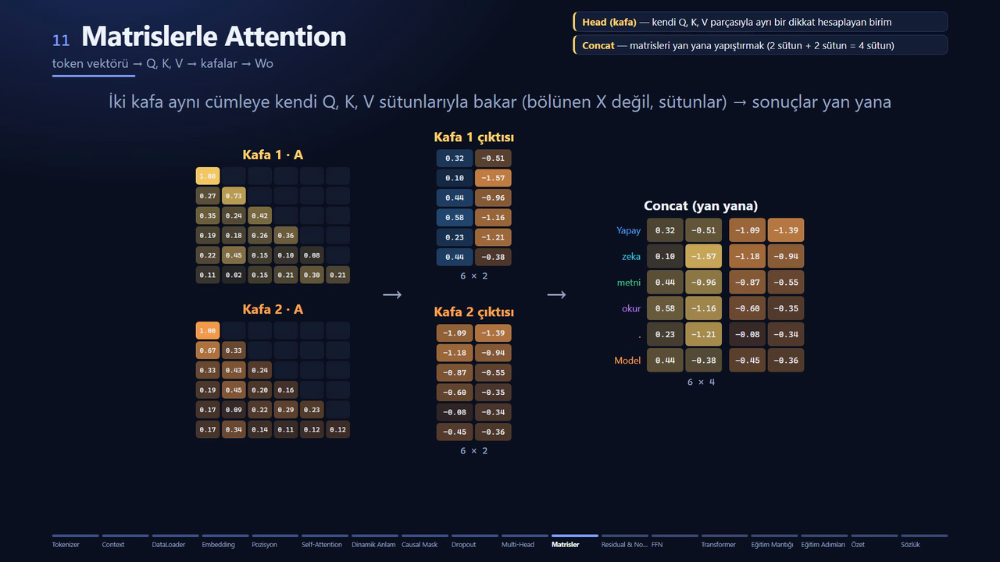</td>
    <td>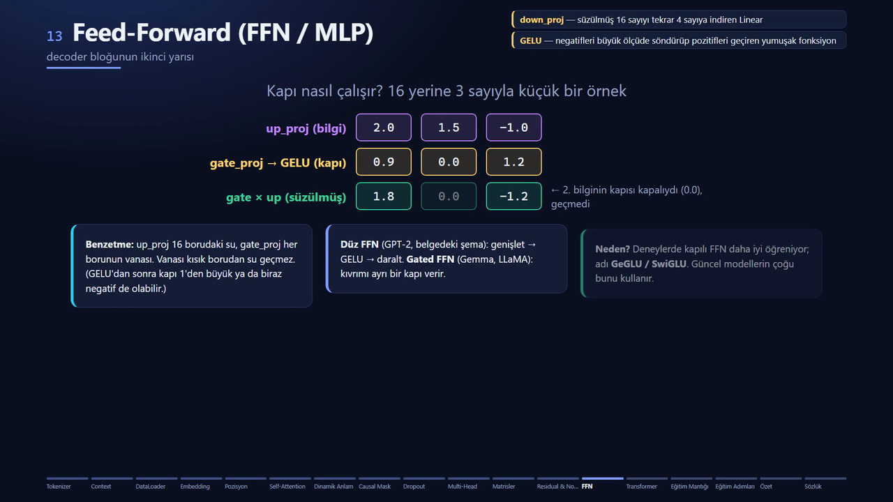</td>
  </tr>
  <tr>
    <td align="center"><sub>İki kafa → concat (yan yana)</sub></td>
    <td align="center"><sub>Gated FFN: up_proj bilgi, gate_proj kapı</sub></td>
  </tr>
  <tr>
    <td>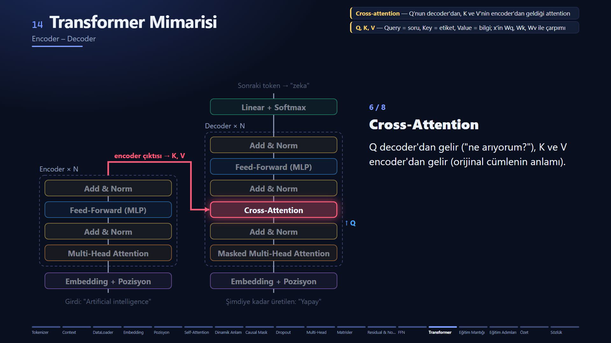</td>
    <td>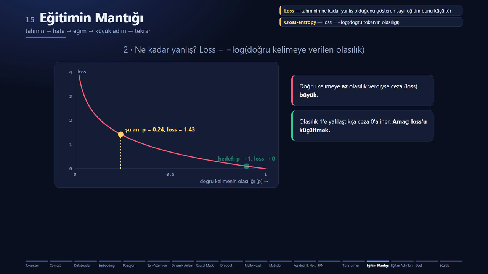</td>
  </tr>
  <tr>
    <td align="center"><sub>Encoder–decoder ve cross-attention</sub></td>
    <td align="center"><sub>Loss = −log(doğru kelimeye verilen olasılık)</sub></td>
  </tr>
  <tr>
    <td>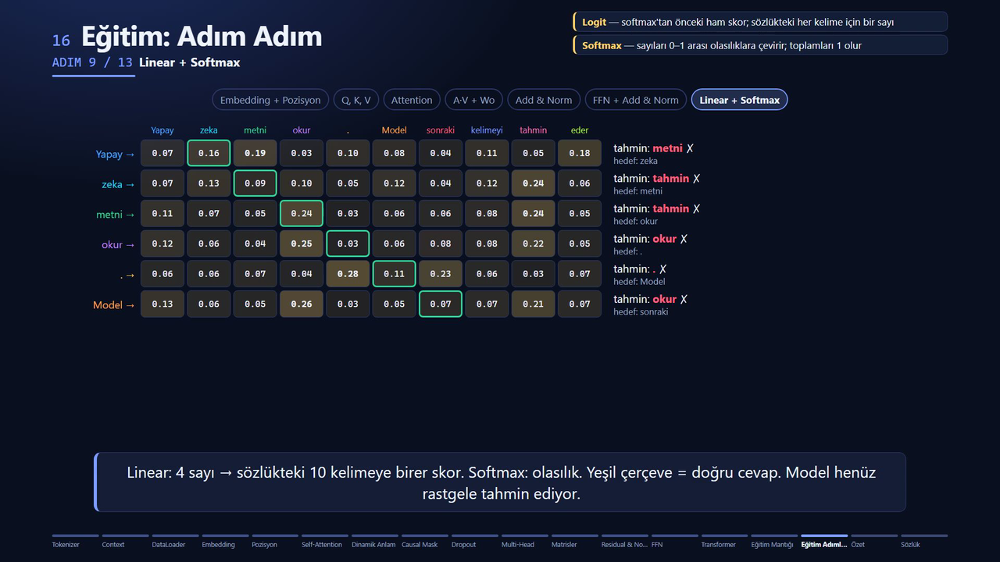</td>
    <td>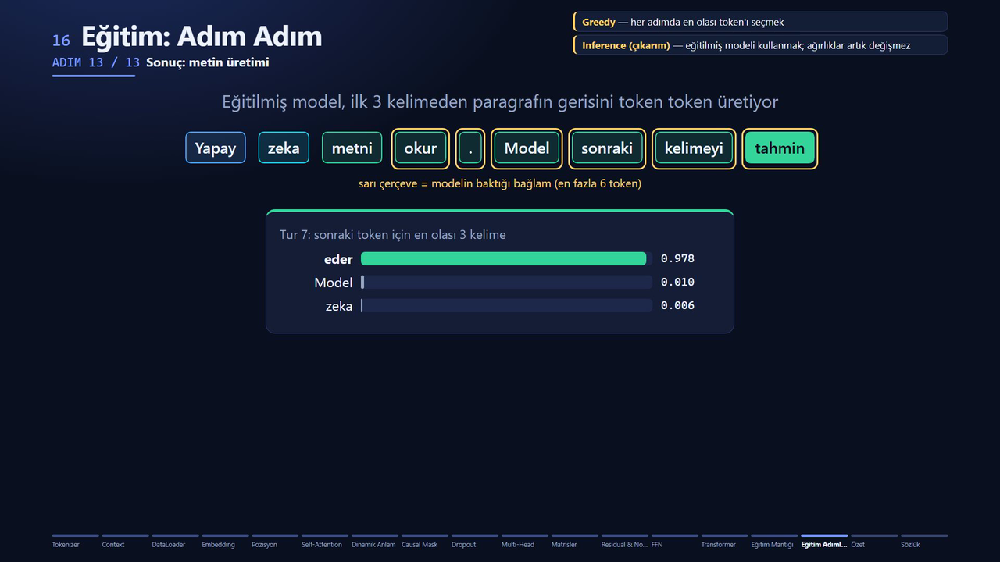</td>
  </tr>
  <tr>
    <td align="center"><sub>Eğitimden önce: model rastgele tahmin ediyor</sub></td>
    <td align="center"><sub>Eğitimden sonra: model paragrafı token token üretiyor</sub></td>
  </tr>
</table>

<details>
<summary>Daha fazla ekran görüntüsü</summary>
<br/>

| | |
|---|---|
| 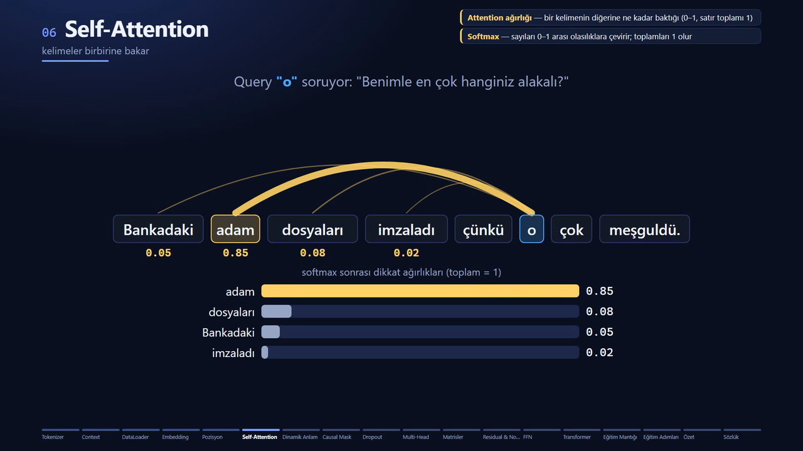 | 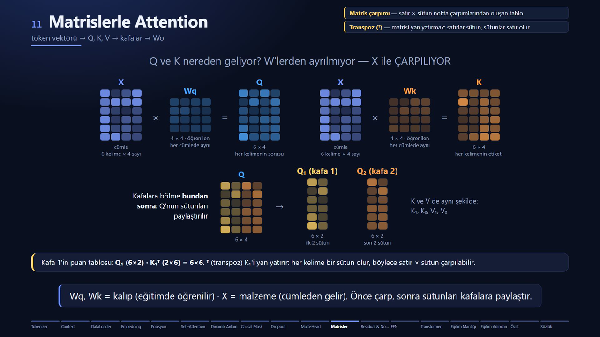 |
| 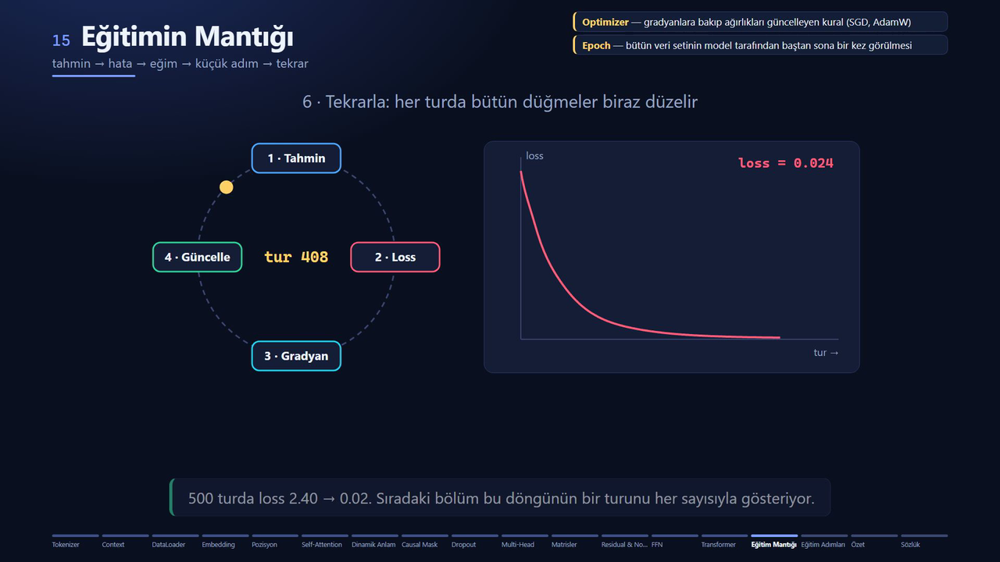 | 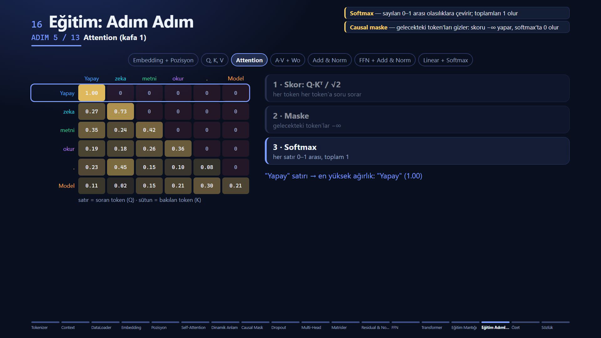 |
| 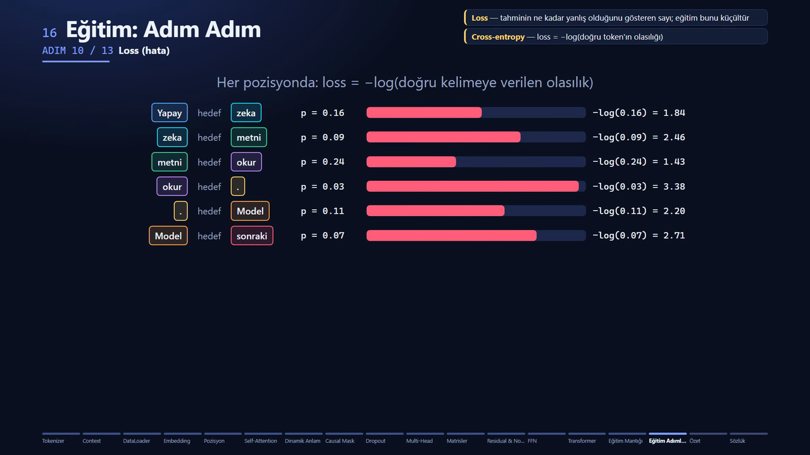 | |

</details>

---

## Sayılar gerçek

Bölüm 11, 13, 15 ve 16'daki **bütün sayılar gerçek bir eğitimden gelir**, uydurma değildir.
[`LLM-Animation/scripts/train_tiny.py`](LLM-Animation/scripts/train_tiny.py) tek bir paragrafla
**332 parametrelik** minik bir Transformer eğitir ve her ara değeri JSON'a yazar; animasyon bu dosyayı okur.

| Ayar | Değer |
|---|---|
| Paragraf | "Yapay zeka metni okur. Model sonraki kelimeyi tahmin eder." |
| Mimari | Decoder-only, 1 blok, öğrenilen pozisyon, post-LN |
| Sözlük | 10 kelime |
| d_model / kafa sayısı / context length | 4 / 2 / 6 |
| FFN | 4 → 16 → 4, GELU |
| Eğitim | SGD, lr = 0.1, 500 adım (loss 2.40 → 0.02) |

Böylece ekranda görülen her Q, K, V matrisi, her attention ağırlığı ve her olasılık birbiriyle tutarlıdır:
X·Wq gerçekten Q'yu verir, kafaların birleşimi × Wo gerçekten bloğun çıktısını verir.

---

## Notebook'lar

Her notebook notlardaki bir bölüme karşılık gelir ve kendi başına çalışır. Sonunda sıfırdan yazılmış küçük bir GPT eğitilir ve metin üretilir.

| # | Notebook | Konu |
|---|---|---|
| 01 | [`01_Tokenizer`](LLM-Notebooks/01_Tokenizer.ipynb) | Kendi tokenizer'ımız, BPE (SentencePiece, HF `tokenizers`), tiktoken |
| 02 | [`02_Context_Length_ve_DataLoader`](LLM-Notebooks/02_Context_Length_ve_DataLoader.ipynb) | Kaydırmalı veri seti, DataLoader |
| 03 | [`03_Embedding`](LLM-Notebooks/03_Embedding.ipynb) | `nn.Embedding` |
| 04 | [`04_Positional_Encoding`](LLM-Notebooks/04_Positional_Encoding.ipynb) | Pozisyon bilgisi, RoPE |
| 05 | [`05_Self_Attention`](LLM-Notebooks/05_Self_Attention.ipynb) | Q, K, V ile self-attention |
| 06 | [`06_Causal_Self_Attention`](LLM-Notebooks/06_Causal_Self_Attention.ipynb) | Causal maske |
| 07 | [`07_Dropout`](LLM-Notebooks/07_Dropout.ipynb) | Dropout |
| 08 | [`08_Multi_Head_Attention`](LLM-Notebooks/08_Multi_Head_Attention.ipynb) | Çok başlı attention |
| 09 | [`09_Residual_ve_Layer_Normalization`](LLM-Notebooks/09_Residual_ve_Layer_Normalization.ipynb) | Residual, LayerNorm |
| 10 | [`10_Transformer_Decoder_Blogu`](LLM-Notebooks/10_Transformer_Decoder_Blogu.ipynb) | Decoder bloğu (MHA + MLP) |
| 11 | [`11_GPT_Modeli_ve_Sonraki_Token`](LLM-Notebooks/11_GPT_Modeli_ve_Sonraki_Token.ipynb) | GPT modeli, sonraki token |
| 12 | [`12_Egitim_ve_Metin_Uretimi`](LLM-Notebooks/12_Egitim_ve_Metin_Uretimi.ipynb) | Eğitim döngüsü, metin üretimi |

Ayrıntılar ve `usta_*.py` modüllerinin listesi: [`LLM-Notebooks/README.md`](LLM-Notebooks/README.md).

---

## Hızlı başlangıç

**Sadece izlemek:** [`assets/LLM-Temelleri.mp4`](assets/LLM-Temelleri.mp4) dosyasını indir (1080p, 17:26, 36 MB).

**Animasyonu kendin açmak / değiştirmek** (Node.js 18+):

```bash
cd LLM-Animation
npm install
npm run studio     # tarayıcıda Remotion Studio: bölüm seç, ileri / geri sar
npm run render     # out/LLM-Temelleri.mp4 dosyasını tam kalitede üretir
npx remotion render 11-Matrislerle-Attention out/11.mp4   # tek bir bölüm
```

**Notebook'ları çalıştırmak** (Python 3.10+):

```bash
pip install torch transformers tokenizers tiktoken sentencepiece plotly jupyter
cd LLM-Notebooks
jupyter notebook
```

> "İsteğe bağlı" başlıklı hücreler gerçek modelleri indirir (Gemma ~2 GB, Qwen ~1.2 GB). Gemma için
> Hugging Face girişi gerekir: `login()` açılan kutuya token'ını gir, **token'ı koda yazma.**
> Bu hücreleri atlarsan notebook'un geri kalanı yine çalışır.

---

## Klasör yapısı

```text
LLM-Fundamentals/
├── LLM Fundamental.pdf / .docx   ders notları
├── assets/
│   ├── LLM-Temelleri.mp4         animasyonun tamamı (sıkıştırılmış)
│   ├── gifs/                     README'deki kısa kesitler
│   └── screens/                  ekran görüntüleri
├── LLM-Animation/                Remotion projesi
│   ├── src/scenes/               her bölüm bir sahne (Tokenizer.tsx, SelfAttention.tsx …)
│   ├── src/terms.ts              ekrandaki terim kutularının açıklamaları
│   ├── src/data/training.json    minik modelin gerçek eğitim verisi
│   └── scripts/train_tiny.py     o veriyi üreten PyTorch betiği
└── LLM-Notebooks/                01–12 notebook'lar + usta_*.py modülleri
```

---

## Kaynaklar

- Kod, Ali Bayram'ın "LLM from scratch" kursundaki `usta_*` modüllerine dayanır: [github.com/malibayram](https://github.com/malibayram) · [Türkçe tokenizer](https://huggingface.co/spaces/alibayram/turkish_tiktokenizer)
- Transformer'ı 3B görselleştirme: [bbycroft.net/llm](https://bbycroft.net/llm)
- [The Illustrated Transformer](https://jalammar.github.io/illustrated-transformer/), Jay Alammar
- Tokenizer deneme alanı: [tiktokenizer.vercel.app](https://tiktokenizer.vercel.app/)
- Makaleler: [Attention Is All You Need](https://arxiv.org/abs/1706.03762), GPT-2, GPT-3
